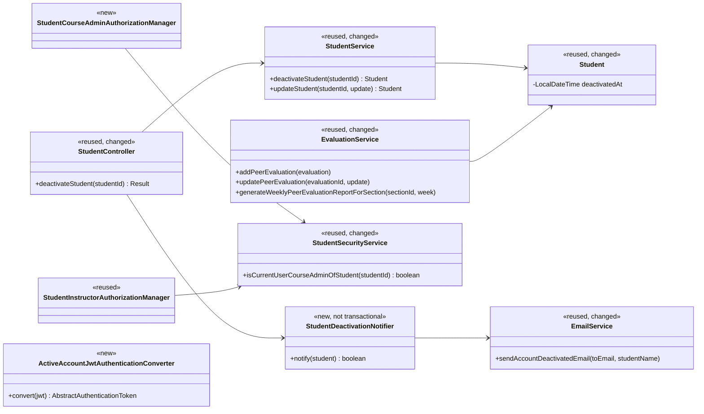
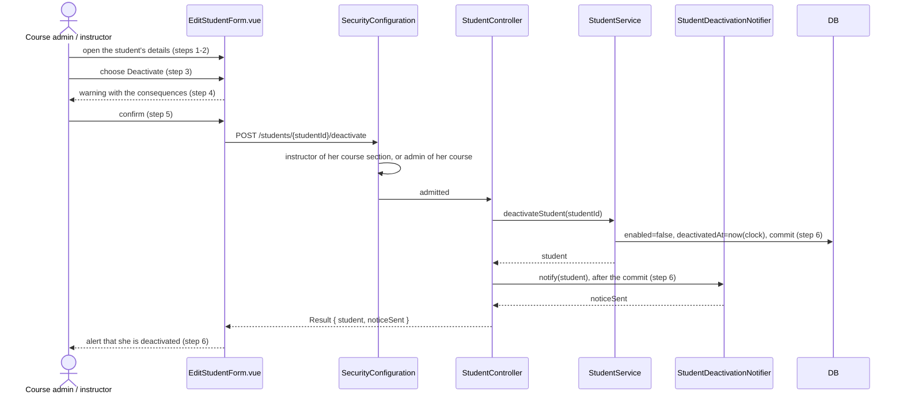
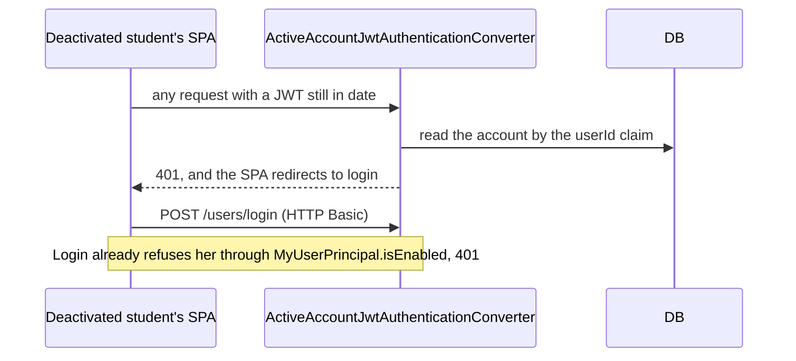

# Student (STU) Design

> Realizes: UC-STU-deactivate-student
> Depends on: FR-SEC-active-account, FR-SEC-authorization, CI-email-notifications, BR-student-lifecycle, BR-submission-owed, BR-deactivated-evaluatee, BR-deactivated-student-report-weeks, BR-evaluation-editable-until-close, BR-team-admin-only, BR-section-scoped-access, BR-role-based-access, CO-ferpa
> See: [use cases](../requirements/use-cases.md#student), [architectural-design.md](architectural-design.md#crosscutting-concepts) (Crosscutting Concepts and the foundation component view), the [SRS Business Domain Model](../requirements/software-requirements-specification.md)
> Designed against `main` at `59f0267` (2026-11-04).

## Overview

Deactivating a student is a dedicated, confirmed action in the `student` slice of the REST API container. It replaces the Status switch that flipped `enabled` alongside name and email. Most of its reach is outside that slice: the account check runs on every authenticated request, and `evaluation` applies the rules about a deactivated evaluatee. `notification` does not change: `SubmissionStatusService.findOwedItems` already skips a deactivated student and counts only active teammates, and the reminders and both instructor report pages take their "has not submitted" lists from it.

`UC-STU-reactivate-student` is not designed here. Until it is, the edit form's Status control remains as its stopgap and offers only reactivation.

## Components & classes

**Backend**
- `student/`: `StudentController`, `StudentService`, `Student`, `StudentRepository` (the scoped finder), `StudentSecurityService`, new `StudentDeactivationNotifier` and `dto/StudentDeactivationDto`.
- `security/`: `SecurityConfiguration`, new `ActiveAccountJwtAuthenticationConverter`, new `authorizationmanagers/StudentCourseAdminAuthorizationManager`.
- `user/UserRepository` (the one-column active-state read).
- `evaluation/EvaluationService`, `system/EmailService`, `system/exception/ExceptionHandlerAdvice`, new `system/exception/StudentAlreadyDeactivatedException` beside the other exceptions the advice maps, so the foundation does not depend on the `student` slice.

**Frontend**
- `pages/students/EditStudentForm.vue`: a Deactivate button for an active student, an `ElMessageBox.confirm` warning with the consequences in the use case's Associated Information, and the Status switch shown only for a deactivated student. The dialog closes after a deactivation, which reloads the Students table.
- `apis/student/`: `deactivateStudent`; its types.
- `pages/evaluations/SubmitTeamsEvaluations.vue`: leaves out a deactivated teammate, for a new form and for one showing submitted evaluations.

## Sequence

### UC-STU-deactivate-student: main success scenario

### UC-STU-deactivate-student: a session already open

## API contract

| Endpoint or job | Caller (who may) | Request | Success | Errors, by extension |
|---|---|---|---|---|
| `POST /students/{studentId}/deactivate` (new) | Course admin of her course, or an instructor assigned to her course section | None | 200, `{ student, noticeSent }` | 3a: 403, also for an unknown id. 6a: 409. 6b is a success with `noticeSent=false` |
| `GET /students/teams/{teamId}` (read by the evaluation form; unchanged) | Unchanged, team members included | None | `StudentDto`, whose existing `enabled` tells the form to leave her out | Unchanged |
| `PUT /students/{studentId}` (behavior changed) | Unchanged | `enabled` applies only from false to true, and clears `deactivatedAt` | Unchanged | A request to disable is ignored, as a student's own `enabled` is today |
| `POST /evaluations`, `PUT /evaluations/{evaluationId}` (behavior changed) | Unchanged | Unchanged | Unchanged | UC-EVA-submit-evaluation 9a: 400 if the evaluatee is deactivated |
| Any request bearing a JWT (behavior changed) | Any | Unchanged | Unchanged | 401 if the account is deactivated or gone (FR-SEC-active-account) |

## Key decisions

- **A dedicated route, not `enabled` on `PUT`.** Rejected keeping the flag on `PUT`: it cannot enforce the warning or record the date, and it mixes with name and email edits. `updateStudent` therefore ignores a change to disabled, so there is one way to deactivate. The edit form sends `enabled` true only when reactivating, because the server reads true on a deactivated student as reactivation: sending the true it loaded for an active student would undo a deactivation someone else made since the form opened.
- **Authorization.** The route's rule is `AuthorizationManagers.anyOf(studentInstructorAuthorizationManager, studentCourseAdminAuthorizationManager)`, the shape the reminder routes use. Rejected reusing `UserOwnershipAuthorizationManager`: it shuts out a course admin not assigned to the course section and admits the student herself, both against BR-student-lifecycle.
- **Scope the load too.** `deactivateStudent` loads through a `StudentRepository` finder keyed on the student id and the caller's id (assigned to her course section, or admin of her course), and an empty result is `ObjectNotFoundException`. This is point 2 of [Authorization](architectural-design.md#authorization). Rejected a primary-key load like the rest of `StudentService`: the route rule would be the only check, and OI-48 records that shape as a gap to stop repeating.
- **A course admin not assigned to the course section assigns herself first.** The Students page lists only her default course section, and she cannot set one she is not assigned to, but she may already add herself as its instructor. The route still admits her directly, as BR-student-lifecycle requires. Rejected widening `GET /students/{studentId}` (no screen would use it) and the default-course-section rule (a shared rule, for a Rare flow). See OI-66.
- **One writer.** `POST /students/{studentId}/deactivate` is the only code that sets a student's `enabled` to false. The `enabled` field stays in `StudentDto`; `deactivatedAt` is not exposed in it.
- **The 6a response.** The server's message is "This student is already deactivated." The shared Axios instance shows it as a toast, and the form then reloads the student so the Deactivate button is gone.
- **Check the account in a wrapper around `JwtAuthenticationConverter`.** The wrapper reads `UserRepository` and throws `DisabledException`, which reaches the existing 401 through `CustomBearerTokenAuthenticationEntryPoint`. Rejected a servlet filter (a second place to order and handle errors), a token blocklist (storage for what one read answers), and shortening the token's life (it narrows the gap but does not close it). Cost: one primary-key read of the `enabled` column per authenticated request; it reads the column rather than the entity, which would also fetch a student's course section, team, and course. A token with a missing `userId` claim, or naming no account, also gets 401. It applies to instructors too, as FR-SEC-active-account requires.
- **Email in the controller, after the service commits.** Rejected sending inside the transaction: it holds the transaction across SMTP, and a failure could undo the deactivation. Rejected `@TransactionalEventListener(AFTER_COMMIT)`: its result cannot reach the response, and 6b needs it. The transaction boundary stays the service method. The send is synchronous, bounded by the configured SMTP timeouts, and the notifier catches any `RuntimeException` from it and returns false, as `ReminderService` does. The email says her account has been deactivated and to contact her instructor; it carries no reason and no student records (CO-ferpa). The SPA words the alerts from `noticeSent`; on 6b the alert says both that she is deactivated and that she could not be notified.
- **She stays on her team.** Rejected removal: the course section report filters on team, an instructor who may deactivate may not remove a student from a team (BR-team-admin-only), and reactivation would leave her teamless.
- **One nullable `deactivatedAt`.** Rejected a table of deactivated periods as too heavy for a Rare, Low-priority use case. Accepted cost: after a reactivation, the weeks in between show no peer evaluations.
- **The report rule.** For week W, a student on a team is listed if she is active; or she has a date and W is before the week of that date; or she has no date and received a peer evaluation for W (BR-deactivated-student-report-weeks). Week keys are zero-padded ISO, so string comparison orders them, and `WeekKeys.of` gives the date's key.
- **Refuse on the server and filter in the SPA.** The filter alone misses a stale page and a direct call. The refusal alone fails a teammate's submission, since the form saves each evaluation in its own request. Those requests run concurrently, so if a stale form hits the 400 (UC-EVA-submit-evaluation 9a), the form waits for all of them to finish, shows the server's message, and reloads, with no success message or receipt; the evaluations saved for her teammates stand. The submission window is checked first, as it is today, then that the two share a team, then the evaluatee, so a student on another team learns nothing about this account. The evaluatee's message is "This teammate's account is deactivated."

## Data model

Adds a nullable `deactivated_at datetime(6)` to `peer_evaluation_user` (single-table inheritance; only `Student` maps it), in Flyway `V7__student_deactivated_at.sql`. No backfill: a student disabled earlier has no date, which the report rule handles. The rest of the model is the SRS's Business Domain Model.

## Reuse & cross-cutting

Login through `MyUserPrincipal.isEnabled`; `WeekKeys`; the injected `Clock`; `StudentInstructorAuthorizationManager`; the lookup pattern of `SectionSecurityService.isSectionOwner`; `CI-email-notifications` through `EmailService`; the SPA's existing 401 redirect in `utils/request.ts`.

## Tests

| Use case, flow | Level (unit / integration) | Asserts |
|---|---|---|
| Main: instructor assigned to her course section | Integration | 200; `enabled` false; `deactivatedAt` from the clock; `noticeSent` true; her weekly activity reports and peer evaluations still exist |
| Main: course admin not assigned to that course section | Integration | The route deactivates her. The test arranges this; the seed has no such course admin |
| Point 2: the scoped load | Unit | With a student outside the caller's scope, `deactivateStudent` throws `ObjectNotFoundException` and changes nothing, with no route rule involved |
| Main: warning, steps 3 to 6 | Cypress, stubbed API | Consequences shown before any request; Confirm sends one POST; success alert shown |
| Main: notification | Unit | Notifier sends one email to her address and returns true |
| POST-2: team | Integration | She is still on her team after deactivation |
| 3a: another course's admin, an unassigned instructor, another student, herself, an unknown id | Integration | 403 and no change |
| 4a: cancel | Cypress, stubbed API | No POST sent; Status unchanged |
| 6a: already deactivated | Integration | 409; original `deactivatedAt` kept; no email |
| 6a: alert | Cypress, stubbed API | The message is shown; the form reloads; the Deactivate button is gone |
| 6b: mail fails | Unit and integration | 200; `noticeSent` false; still deactivated |
| 6b: alert | Cypress, stubbed API | The alert says she is deactivated and could not be notified |
| Open session (FR-SEC-active-account) | Integration | Her earlier JWT gets 401 on the next request |
| Login (FR-SEC-active-account) | Integration | Login returns 401 |
| Active account | Integration | A valid JWT still passes the converter |
| Deactivated instructor (FR-SEC-active-account) | Integration | A valid JWT gets 401 |
| Reminders (BR-submission-owed) | Unit | She owes nothing, and her teammates do not owe a peer evaluation of her |
| UC-EVA-submit-evaluation 9a: new evaluation of her | Unit and integration | 400; nothing saved |
| BR-deactivated-evaluatee: edit of an evaluation of her, inside its window | Unit and integration | 400; unchanged |
| BR-deactivated-evaluatee: evaluations she wrote | Unit | Still count in her teammates' averages |
| UC-EVA-submit-evaluation 2a: the form | Cypress, stubbed API | She is left out of new and submitted forms; submitting sends nothing for her |
| UC-EVA-submit-evaluation 2a: the data the form needs | Integration | A teammate calling `GET /students/teams/{teamId}` receives `enabled` false for her. The stubbed Cypress test cannot show this |
| UC-EVA-submit-evaluation 9a: stale form | Cypress, stubbed API | On the 400, the message is shown, no receipt is sent, and the form reloads |
| Report, date recorded | Unit | Deactivated in week W: listed for W-1, not for W or later |
| Report and owed list, week W-1 | Unit | She is listed in the report for W-1 but is not among those who owe a peer evaluation for it |
| Report, no date | Unit | Listed only for weeks with peer evaluations |
| Report, active student with no peer evaluations | Unit | Still listed |
| `PUT`: disable | Unit and integration | Ignored, even from an instructor. Replaces the assertion in `StudentServiceTest` near line 177 |
| `PUT`: enable | Unit and integration | Enabled; date cleared; team kept |
| Status switch | Cypress, stubbed API | Hidden for an active student; shown for a deactivated one |
| Stale edit form | Cypress, stubbed API | Saving an active student sends `enabled` false; `enabled` is true only once the switch is turned on for a deactivated one |

The Cypress specs need the dev stack and are not in CI. If they are not run, Verify stays `🟡 Partial`.

## Open questions / risks

- Two simultaneous deactivations can both pass the 6a check and email twice. Harmless on a Rare flow, so no locking is added.
- A course admin not assigned to the course section must assign herself before she can reach the student in the UI (OI-66).
- A student deactivated in week W can be left partly rated or unrated for W-1, because evaluations of W-1 are written during W and stop at deactivation. She is listed for W-1 regardless, and not for W or later (BR-deactivated-evaluatee, BR-deactivated-student-report-weeks). Her weekly activity reports remain.
- A student whose stale form hits the 9a refusal gets no receipt, though every active teammate's evaluation may have saved. Harmless on a Rare flow: reopening the form shows them.
- OI-65 is a separate gap on the neighboring delete route and is not addressed here.
